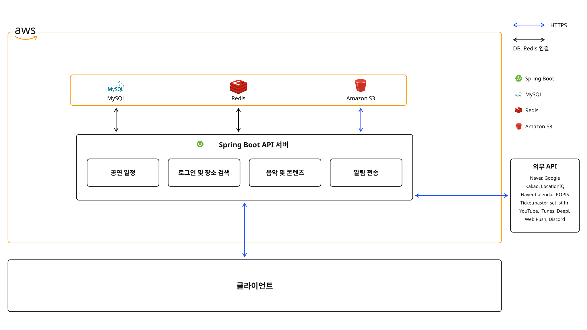
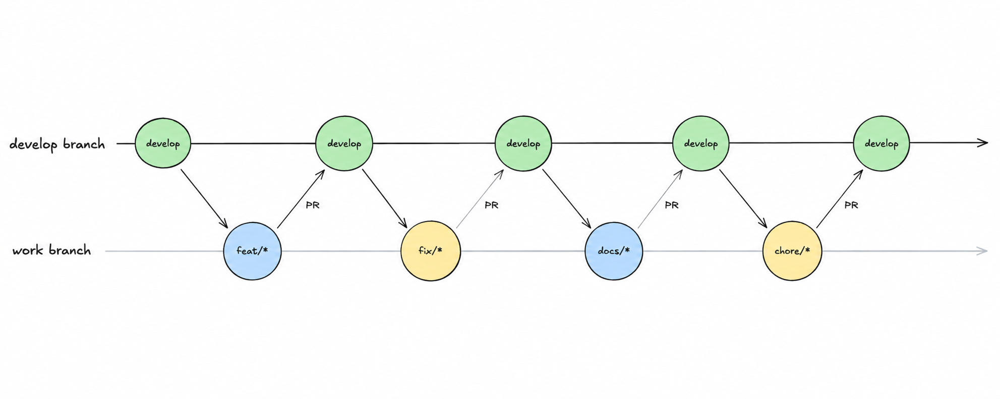

# 잔스페이스 Backend

> 공연의 순간을 기록하고, 나의 여정을 별로 남기는 공연 기록 서비스

## 💬 프로젝트 목적

**잔스페이스(Janspace)**는 공연 일정 확인부터 관람 기록까지 연결하는 공연 기록 서비스.

여러 서비스에 흩어진 공연 일정과 셋리스트를 모으고, 관람 기록, 포토카드 및 티켓을 연결하여 공연 전후의 경험을 한곳에 보관하는 것이 목적.

한 아티스트를 대상으로 운영하는 구조이며, 외부 데이터 수집 대상은 환경변수로 설정.

## 🧩 주요 기능

| 영역 | 주요 기능 |
| --- | --- |
| 계정 | 네이버, Google 소셜 로그인, JWT 인증, refresh token rotation |
| 공연 및 음악 | 외부 API 기반 공연 일정 통합, 곡 및 앨범 관리, 셋리스트 편집 및 변경 이력 |
| 관람 기록 | 관람 여부, 감정, 곡 기록, 이동 거리, 누적 통계, 별자리 |
| 포토카드 및 티켓 | 포토카드, 프레임 관리, OCR 텍스트 기반 공연 매칭, 티켓북 |
| 알림 및 운영 | 웹 푸시 예약 및 재시도, 관리자 변경 승인, 동기화 이력, 운영 알림 |

## 🛠️ 기술 스택

| 구분 | 기술 |
| --- | --- |
| Language / Framework | Java 21, Spring Boot 4.0.8, Spring MVC, Spring Security |
| Database / Storage | MySQL 8.4, Spring Data JPA, Redis 7, AWS S3 |
| Authentication / Integration | OAuth 2.0, JWT, RestClient |
| Test / API Docs | JUnit 5, Testcontainers, MockMvc, ArchUnit, Swagger |

## 🏛️ 백엔드 아키텍처

## ✅ Commit 타입

| 타입 | 용도 |
| --- | --- |
| `feat` | 새로운 기능 추가 |
| `fix` | 버그 수정 |
| `docs` | 문서 수정 |
| `style` | 동작 변경 없는 코드 포맷 정리 |
| `refactor` | 동작을 유지하는 코드 구조 개선 |
| `test` | 테스트 추가 및 수정 |
| `chore` | 의존성, 설정, 기타 유지보수 |
| `design` | UI 디자인 변경 |
| `comment` | 주석 추가 및 수정 |
| `rename` | 파일 및 폴더 이름 변경 또는 이동 |
| `remove` | 파일 삭제 |
| `hotfix` | 긴급한 버그 수정 |

## 🌿 Branch 컨벤션

